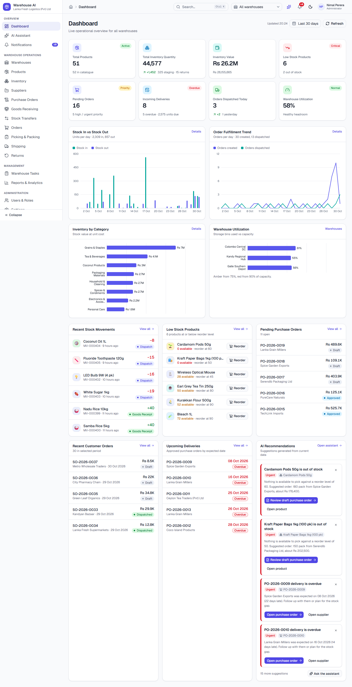

# Warehouse AI — AI-powered Warehouse Management System (frontend prototype)

A complete, interactive **frontend-only** WMS prototype for demos, UX feedback and requirements validation. It runs entirely in the browser on realistic, interconnected Sri Lankan mock data (LKR by default). There is **no backend, database, authentication server or external AI** — the "AI" is a deterministic engine that reads the live mock data.



## What you can do

| Area | Highlights |
| --- | --- |
| **Dashboard** | 8 live KPIs, 4 charts (stock in/out, order fulfilment, inventory by category, utilisation), 6 widgets, warehouse + date-range scoping |
| **Warehouses** | Multiple warehouses; Warehouse → Zone → Rack → Bin hierarchy; capacity/utilisation; add zones/racks/bins |
| **Products & Suppliers** | Catalogue with images, SKU generation, barcodes, CSV export; supplier management with PO history |
| **Inventory** | On-hand / reserved / blocked / available per bin, movement history, stock adjustments (never negative), stock counts with reconciliation |
| **Purchasing → Receiving** | PO lifecycle (Draft → Approved → Partially Received → Received), GRN wizard, partial receiving, damaged qty, **staging → putaway** |
| **Transfers** | Bin-to-bin and inter-warehouse (Draft → Pending Approval → Approved → In Transit → Completed) with separate in-transit quantities |
| **Orders → Shipping** | Availability-checked orders, stock reservation, picking with mock barcode scans, packing slips, shipments, dispatch |
| **Returns** | Requested → Received → Inspected → Restocked / Rejected — returned goods are never auto-sellable |
| **Tasks / Notifications / Users / Settings** | Table + Kanban tasks linked to records, notification centre, simulated roles, persisted settings, **Reset Demo Data** |
| **AI Assistant** | Chat page + header drawer, suggested prompts, data-answer cards, recommendation cards (dismissible, link to pre-filled drafts). It only *recommends* — it never changes stock |
| **Reports** | 6 reports with filters, charts, tables, CSV export, printable views and an AI summary |

## Quick start

```bash
npm install
npx playwright install chromium     # only needed to run the tests / screenshots
npm run dev                         # http://localhost:3000
```

Production build: `npm run build && npm start`. Data lives in your browser's `localStorage` (key `wms-state`), so refreshes keep your work; **Settings → Data → Reset Demo Data** regenerates a fresh seed.

> Use the **user menu → Switch demo user** to see role-based navigation (Administrator, Warehouse Manager, Inventory Manager, Warehouse Operator). Roles are *simulated* for demos — they hide navigation and disable actions but are **not** real security.

## Scripts

| Script | Purpose |
| --- | --- |
| `npm run dev` / `build` / `start` | Next.js |
| `npm run typecheck` | Strict TypeScript |
| `npm run lint` | ESLint |
| `npm run check:seed` | Verifies the generated data (see below) |
| `npm run check:ai` | Unit checks for the mock AI engine |
| `npm run test:e2e` | Playwright (desktop + mobile) — see [TESTING.md](TESTING.md) |
| `npm run screenshots` / `npm run videos` | Regenerate `artifacts/screenshots` and `artifacts/videos` |

## How the data stays consistent

Everything shares **one store** (`src/stores/wms-store.ts`, Zustand + localStorage, versioned by `SEED_VERSION`). UI components never mutate data; they call **transaction functions** (`src/lib/workflows/*`) that validate, apply the change to a cloned draft, write stock movements/tasks/notifications, and commit only if everything succeeded.

Stock rules (`src/lib/inventory/selectors.ts`):

* **On-hand** – physical units in a bin. **Reserved** – allocated to confirmed orders. **Blocked** – quarantined.
* **Available** = on-hand − reserved − blocked, for *storage* bins only.
* **Staging** (received, awaiting putaway) and **returns** (awaiting inspection) are physical stock but **never pickable**.
* **In-transit** lives on the dispatched transfer until received — never double counted.
* Dispatch reduces on-hand **and** releases the reservation; every on-hand change writes exactly one movement.

The **seed is not hand-written**: it replays ~75 days of history (opening balances, POs, receipts, putaway, orders, picking, packing, shipping, transfers, adjustments, returns) through those same transactions, anchored to the current date so the app always looks live. `npm run check:seed` asserts that:

* the replay produced no failed transactions,
* **movement history equals on-hand** for every product × warehouse,
* **reservations equal open-order allocations**,
* there is no negative stock, SKUs/codes are unique, and no bin exceeds capacity.

The Playwright suite re-checks both invariants (`window.__wms.integrity()`) after every UI-driven workflow.

## Project structure

```
src/
  app/(dashboard)/<route>/page.tsx   thin route pages (all client components)
  components/
    layout/    shell: sidebar, header, breadcrumbs, search, notifications, theme, user menu
    shared/    reusable kit: DataTable, StatCard, StatusBadge, dialogs, StepProgress, selectors…
    charts/    Recharts wrappers (CSS-variable colours → light/dark safe)
    ai/        chat panel, recommendation card/widget, assistant drawer
    ui/        shadcn/ui (Base UI flavour) primitives
  features/    one folder per module (dashboard, inventory, purchasing, receiving, orders, …)
  lib/
    inventory/ selectors (stock maths) + core mutation primitives
    workflows/ transaction functions per domain
    mock-ai/   deterministic intent engine, recommendations, report summaries
  data/mock/   catalog + seed generator
  stores/      Zustand store (persistence, versioned reset)
tests/e2e/     Playwright specs;  scripts/  seed & AI checks;  docs/DEV_NOTES.md  contributor guide
```

## Tech stack

Next.js 16 (App Router) · TypeScript (strict) · Tailwind CSS v4 · shadcn/ui (Base UI) · Lucide · React Hook Form + Zod 4 · Recharts · TanStack Table v8 · Zustand · date-fns · Sonner · next-themes · Playwright.

## Scope & known limitations

Out of scope by design: real backend/auth/payments, courier or LLM integrations, 3D maps, RFID/IoT, advanced accounting. Notes on the prototype:

* Data is per-browser (localStorage); there is no multi-user sync.
* Barcode scanning is simulated (type a code or press "Simulate scan").
* Roles are demo-only (see above).
* Currency conversion uses fixed illustrative rates; amounts are stored in LKR.
* The seed is anchored to the date the data was first generated; use **Reset Demo Data** to re-anchor to today.

More: [USER_GUIDE.md](USER_GUIDE.md) · [TESTING.md](TESTING.md) · [docs/DEV_NOTES.md](docs/DEV_NOTES.md)
