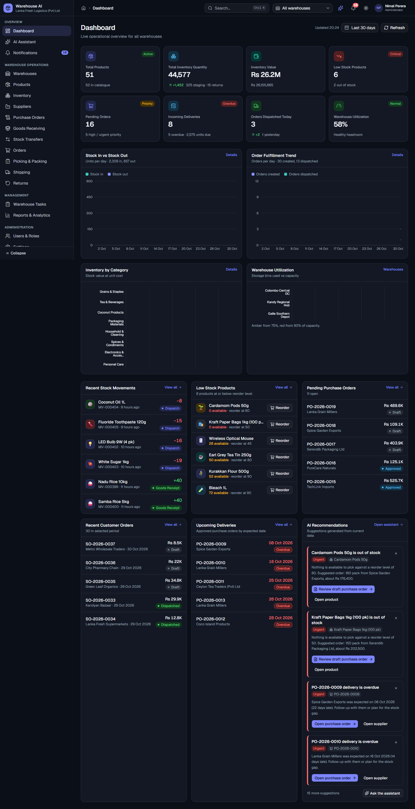
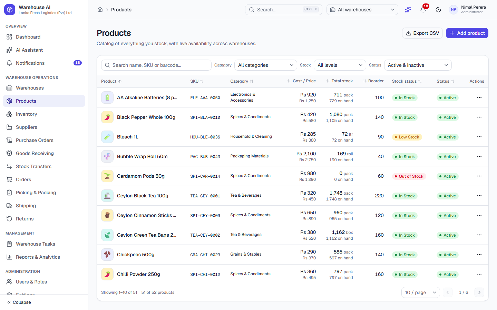
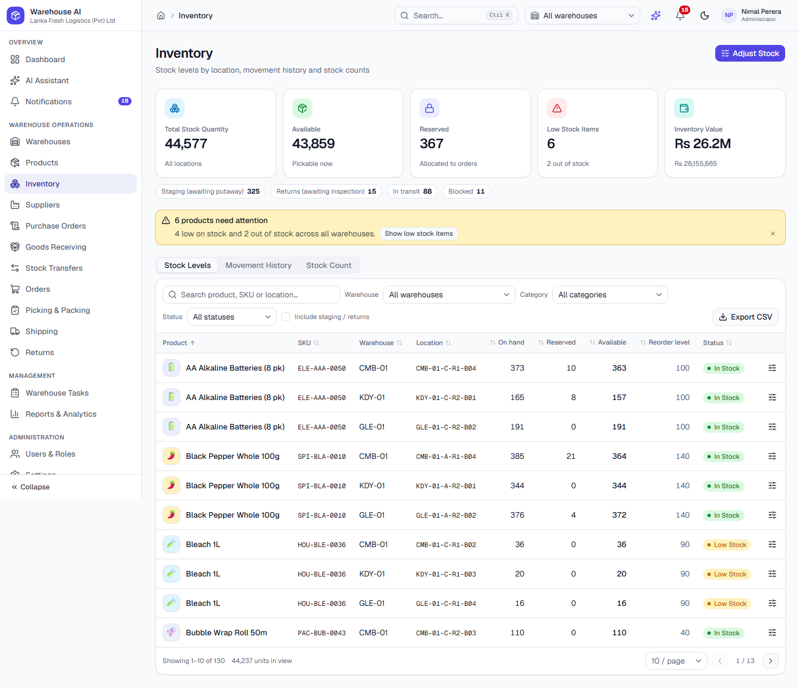
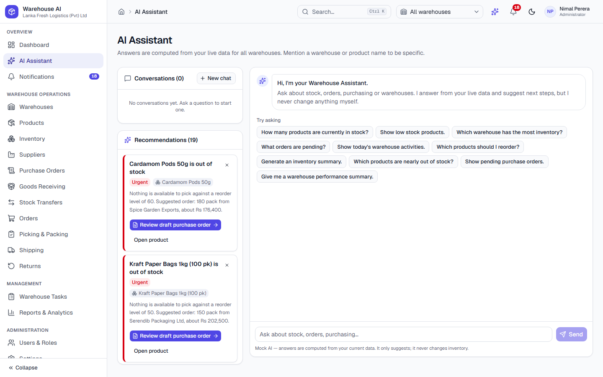

# User guide

Warehouse AI is a demo warehouse management system. This guide walks through the navigation and the main workflows. Screenshots are generated by Playwright (`npm run screenshots`) and live in `artifacts/screenshots/light` and `artifacts/screenshots/dark`; recordings of the key workflows are in `artifacts/videos`.

## Finding your way around

* **Sidebar** (collapsible, a drawer on phones) groups the app into *Overview*, *Warehouse Operations*, *Management* and *Administration*.
* **Header**: breadcrumbs, global search (`Ctrl/⌘ + K` — products, orders, POs, transfers, warehouses, suppliers), the **warehouse selector** (scopes the dashboard, inventory, reports and most lists), the AI assistant drawer, notifications, the light/dark theme toggle, and your profile menu.
* **Demo roles**: *Profile menu → Switch demo user*. Operators, inventory managers, warehouse managers and administrators see different navigation and actions. This is simulated and not real security.
* Every list supports search, filters, sorting and pagination; most have **Export CSV**. Click a row to open its detail page.

## 1. Dashboard
Eight KPI cards (click one to jump to the related module), four charts and six widgets (recent movements, low stock, pending purchase orders, recent orders, upcoming deliveries, AI recommendations). Change the **warehouse** in the header and the **date range** at the top right; **Refresh** recomputes from current data. Every number is derived from the same records the other modules show.

## 2. Master data
* **Warehouses** – create/edit, activate/deactivate (blocked while there are open orders). A warehouse's detail page has *Overview*, *Storage Locations* (Warehouse → Zone → Rack → Bin; add zones, racks and bins), *Inventory* and *Recent Activity*.
* **Products** – add/edit with image upload or emoji, *Generate* a SKU, set reorder level and preferred supplier; archive instead of deleting. The detail page shows barcode, stock per warehouse/bin and the full movement history.
* **Suppliers** – add/edit, activate/deactivate, see their purchase orders and products.

## 3. Inventory
The table shows each product × storage location with on-hand, reserved, available and a status badge (In Stock, Low Stock, Out of Stock, Reserved, Blocked).

* **Adjust Stock**: choose product, warehouse, location, type (add / remove / set counted / block / unblock), quantity and reason, confirm. The dialog previews the new on-hand and refuses anything that would go negative or touch reserved units. Each adjustment writes a movement.
* **Movement History** tab lists every stock movement with reference, type, quantity, source → destination, date and who did it.
* **Stock Count** tab lets you enter counted quantities, shows variances, applies them as adjustments and runs a **reconciliation check** (movement history vs. on-hand).

## 4. Receive new stock (Scenario A)
1. **Purchase Orders → New**: choose supplier, warehouse and expected date, add products (quantity, unit cost; totals calculate automatically). *Save draft* or *Save & approve*.
2. On the approved PO click **Receive goods** (or use **Goods Receiving → Expected deliveries**). The wizard: review expected items → enter received and damaged quantities (partial receiving is fine) → confirm. A **GRN** is generated and the PO becomes *Partially Received* or *Received*.
3. Received units land in **staging** and putaway tasks are created. They are **not available yet**.
4. **Goods Receiving → Putaway**: pick a bin (a suggestion is pre-selected) and **Complete putaway**. Only now does the stock become available in Inventory, and the dashboard KPIs update.

Video: `artifacts/videos/goods-receiving.webm`

## 5. Transfer stock (Scenario C)
**Stock Transfers → New**. Same warehouse = simple *bin-to-bin* move (completes immediately). Different warehouses = *inter-warehouse*: submit → approve → dispatch (stock leaves the source and is tracked **in transit**) → receive at the destination (choose bins). Requests larger than available stock are rejected.

Video: `artifacts/videos/stock-transfer.webm`

## 6. Fulfil a customer order (Scenario B)
1. **Orders → New**: pick the customer and warehouse, add products. Each line shows live availability; orders you can't fulfil can be saved as draft but not confirmed.
2. **Confirm** reserves the stock (available goes down, on-hand unchanged) and creates picking tasks.
3. **Picking & Packing → Picking**: open a task, scan (or *Simulate scan*) the product and bin, and confirm the **exact** quantity — over- and short-picks are rejected. When every line is picked, move to **Packing**: verify items, enter packaging type, package count and weight, then **Mark as packed** to get the packing slip.
4. **Shipping → Ready to ship → Create shipment** (carrier, method, tracking number), then **Confirm dispatch**. On-hand is reduced, the reservation is released, dispatch movements are written and the order becomes *Dispatched*. Shipments can then be marked *In transit* and *Delivered*.

Video: `artifacts/videos/order-fulfillment.webm`

## 7. Returns
**Returns → New** from a dispatched order (you can only return what was shipped). Then: *Mark as received* (goods go to the returns area, not sellable) → *Inspect* (good vs. damaged quantities) → *Approve restocking* (only good units become available; damaged ones are written off) or *Reject*.

## 8. Tasks, notifications, users, settings
* **Warehouse Tasks**: table or Kanban; tasks created by workflows (putaway, picking, packing, transfers) link back to their records. Putaway can be completed from the task; picking/packing tasks complete when you finish the real step.
* **Notifications**: unread badge in the header; mark read / all read, open the related record, clear read ones. Low-stock, PO approved, goods received, ready for picking, dispatched, transfer completed, return processed, task assigned and AI messages are generated automatically.
* **Users & Roles**: add/edit users, roles and warehouses, activate/deactivate, view a role's permission matrix, **Switch to this user** to try their view.
* **Settings**: company name/logo, currency (display only), date format and timezone, light/dark/system theme, sidebar default, default warehouse, low-stock threshold factor, adjustment rules, notification preferences, AI options. **Data → Reset Demo Data** restores the original seed.

## 9. AI Assistant
Open **AI Assistant** (or the sparkle icon in the header). Try the suggested prompts — *"Show low stock products."*, *"Which products should I reorder?"*, *"Which warehouse has the most inventory?"*, *"What orders are pending?"*, *"Give me a warehouse performance summary."* Answers are computed from the current data at the moment you ask, with tables and links to the relevant pages.

Recommendation cards explain *why*, show the related record and a priority, and offer a navigation button — for example **Review draft purchase order** opens a pre-filled PO form that **you** review and save. You can dismiss a card. The assistant never changes inventory or submits anything itself, and it says so. Unsupported questions get a friendly fallback with supported examples.

## 10. Reports
Choose a report (Inventory Summary, Stock Movement, Low Stock, Purchase Orders, Sales Orders, Warehouse Performance), then a date range, warehouse and category. Each report has KPIs, a chart, a detail table, **Export CSV**, a **Print** view and an AI summary written from the same data.

## Tips
* Everything you do persists in your browser. Use **Settings → Data → Reset Demo Data** to start over.
* On a phone, use the menu button for navigation; tables become cards, and the picking list is designed for touch.
* Dark mode follows the toggle in the header (or *System* in Settings).
